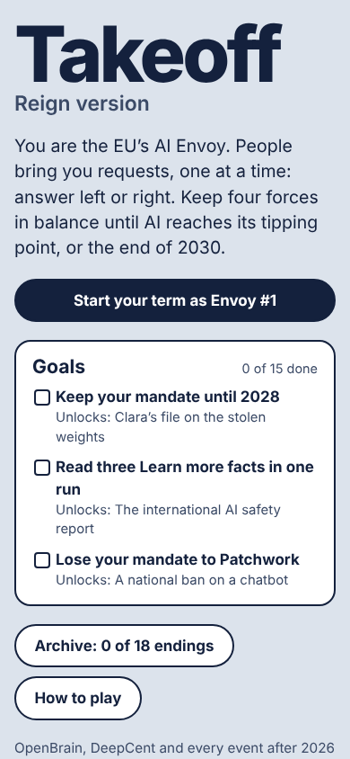
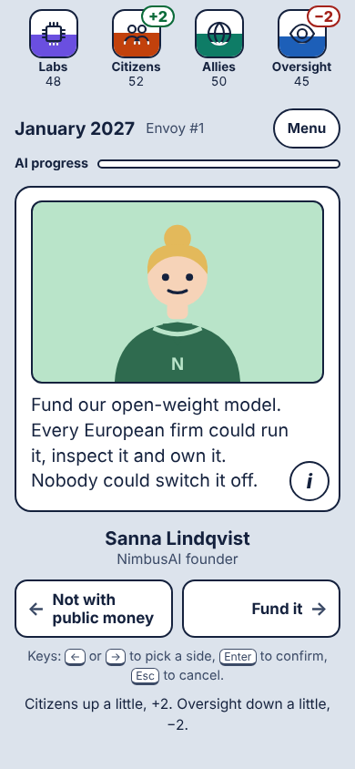
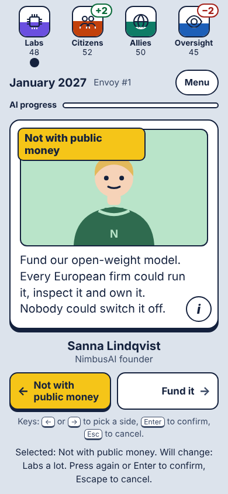
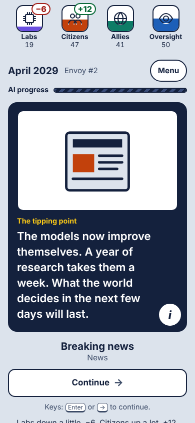
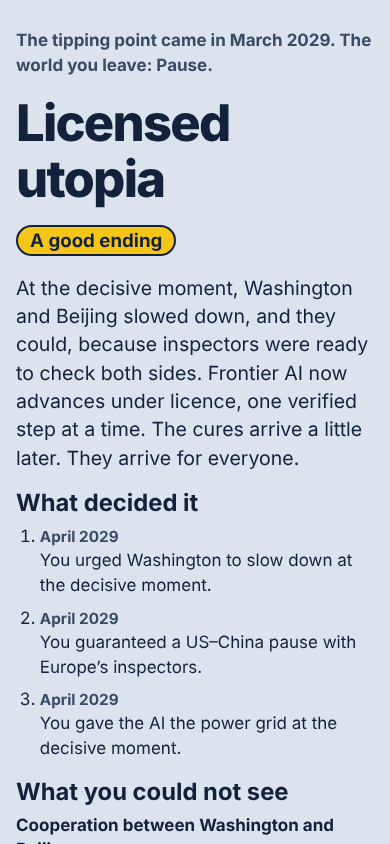
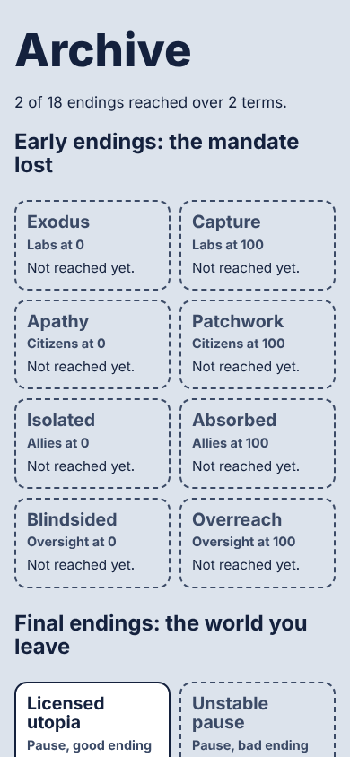

# Takeoff: Reign Version

A short, replayable swipe game about AI governance. You are the EU's AI Envoy: people bring you requests one at a time, and you answer left or right. Keep Labs, Citizens, Allies and Oversight away from 0 and 100 until AI reaches its tipping point, or the end of 2030. What you could not see (whether Washington and Beijing cooperate, whether the AI is truly safe, whether Europe's AI is open) decides which of ten endings you get.

Play: https://damienlethiec.github.io/takeoff-reign-version/

- Design spec: [docs/SPEC.md](docs/SPEC.md)
- What the content rests on (AI 2027, CFG): [docs/SCENARIO_BASIS.md](docs/SCENARIO_BASIS.md)
- Exact rules, numbers and simulation results: [docs/DEVELOPER_NOTES.md](docs/DEVELOPER_NOTES.md)
- Build notes, realism notes, known issues: [docs/BUILD_NOTES.md](docs/BUILD_NOTES.md)

## Develop

```sh
npm install
npm run dev        # http://localhost:5173/takeoff-reign-version/  (?seed=N, ?notutorial, ?fresh)
npm test           # unit tests: content rules, engine, balance guardrails, UI helpers
npm run sim        # 2000 seeded runs per strategy, checked against the spec's targets
npm run build      # production build in dist/, with a Content-Security-Policy meta tag
npm run lint
npm run test:e2e   # Playwright on the production build
npm run a11y       # axe on every screen + whole runs played with the keyboard alone
npm run shots      # screenshots of every screen into docs/screenshots/
```

Pushing to `main` deploys to GitHub Pages; every other branch gets a preview at `/takeoff-reign-version/preview/<branch>/` (Settings → Pages → Deploy from a branch, `gh-pages`, `/`). See `.github/workflows/deploy.yml`.

## Screens

| | | |
| --- | --- | --- |
|  |  |  |
|  |  |  |
